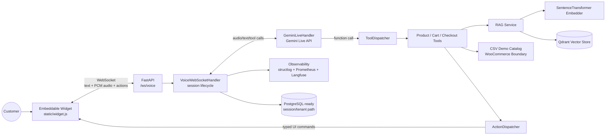
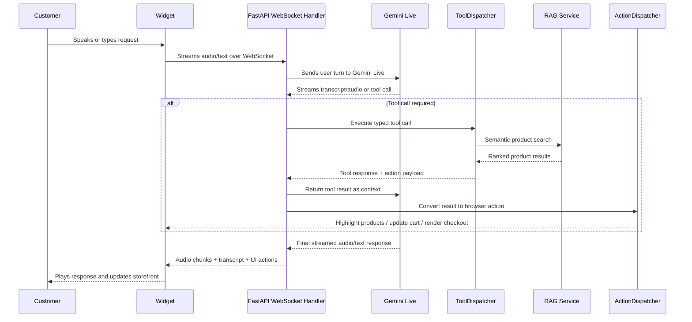
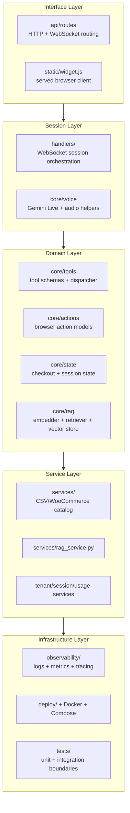
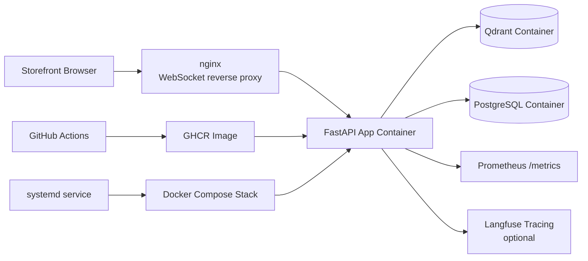

<div align="center">

# Voice Commerce Agent

**Real-time AI voice commerce system for storefronts.**

Speak naturally → retrieve products semantically → trigger storefront UI actions → manage cart and checkout through one embeddable widget.

<p>
  <a href="https://www.python.org/"></a>
  <a href="https://fastapi.tiangolo.com/"></a>
  <a href="https://ai.google.dev/gemini-api/docs/live"></a>
  
  <a href="https://qdrant.tech/"></a>
  <a href="https://www.docker.com/"></a>
</p>

<p>
  <a href="https://www.postgresql.org/"></a>
  <a href="https://docs.pydantic.dev/"></a>
  <a href="https://docs.astral.sh/ruff/"></a>
  <a href="https://docs.pytest.org/"></a>
  <a href="LICENSE"></a>
</p>

<p>
  <a href="#overview">Overview</a> ·
  <a href="#demo">Demo</a> ·
  <a href="#architecture">Architecture</a> ·
  <a href="#repository-structure">Structure</a> ·
  <a href="#core-features">Features</a> ·
  <a href="#running-locally">Run Locally</a> ·
  <a href="#deployment-assets">Deployment</a>
</p>

</div>

<p align="center">
  
</p>

<p align="center"><em>Voice query → semantic retrieval → browser highlights → cart and checkout actions.</em></p>

---

## Overview

Voice Commerce Agent is a production-oriented AI application that connects a storefront widget to a real-time voice assistant. The assistant can understand shopping intent, call typed backend tools, retrieve products through semantic search, and send structured UI actions back to the browser.

This is not a chatbot wrapper. It combines real-time audio streaming, LLM tool calling, retrieval-augmented product search, browser-side actions, observability, and deployment scaffolding in one system.

### At a glance

| Area | What is implemented |
| --- | --- |
| Realtime interaction | Voice/text conversation through Gemini Live and FastAPI WebSockets |
| Product intelligence | RAG product search using sentence-transformers and Qdrant |
| Tool execution | Product search, cart operations, checkout flow, and session-aware tool calls |
| Browser actions | Product highlights, filters, cart updates, checkout overlays, transcripts, and audio playback |
| Demo mode | Repeatable CSV-backed catalog and local storefront demo |
| Production layers | Pydantic contracts, structured logging, Prometheus metrics, Langfuse tracing, usage/cost tracking |
| Deployment assets | Docker, Compose, PostgreSQL, Qdrant, nginx, systemd, and GitHub Actions scaffolding |

---

## Demo

### Voice widget on storefront

<p align="center">
  
</p>

<table>
  <tr>
    <td width="50%">
      
      <p><strong>Semantic search results</strong><br />The assistant retrieves relevant products and highlights them in the browser while explaining the results.</p>
    </td>
    <td width="50%">
      
      <p><strong>Cart and guided checkout</strong><br />Voice-guided cart and checkout flow with shipping, payment selection, order summary, and confirmation.</p>
    </td>
  </tr>
  <tr>
    <td colspan="2">
      
      <p><strong>Voice-guided filtering and ranking</strong><br />The assistant applies filters and ranking actions directly to the storefront DOM.</p>
    </td>
  </tr>
</table>

---

## Architecture

### High-level system



### One voice turn



### Backend layering



### Deployment topology



### Why this architecture matters

- **Routes stay thin** and only wire HTTP/WebSocket entrypoints.
- **Session orchestration lives in handlers**, not inside route functions.
- **Gemini integration is isolated** behind `GeminiLiveHandler`.
- **Tool execution is separated from browser actions** through `ToolDispatcher` and `ActionDispatcher`.
- **RAG is independent** from Gemini and product/cart logic.
- **Pydantic contracts define boundaries** between tools, browser actions, and API responses.
- **Observability is a system layer**, not an afterthought.

---

## Repository Structure

```text
voice-commerce-agent/
├── src/
│   └── voice_commerce/
│       ├── main.py                    # FastAPI app factory and lifespan wiring
│       ├── api/
│       │   ├── middleware/            # CORS and request middleware
│       │   └── routes/                # HTTP/WebSocket route definitions
│       ├── config/                    # pydantic-settings configuration
│       ├── core/
│       │   ├── actions/               # Browser action models and dispatcher
│       │   ├── rag/                   # Embeddings, retrieval, Qdrant wrapper
│       │   ├── state/                 # Checkout/session state models
│       │   ├── tools/                 # Gemini tool schemas, dispatcher, implementations
│       │   └── voice/                 # Gemini Live handler and audio helpers
│       ├── handlers/                  # WebSocket session orchestration
│       ├── models/                    # Shared Pydantic contracts
│       ├── observability/             # structlog, Prometheus, usage, costs, Langfuse
│       └── services/                  # Catalog, RAG, session, tenant, external boundaries
├── static/
│   ├── widget.js                      # Embeddable storefront widget
│   ├── embed_demo.html                # Local storefront demo
│   └── test_client.html               # Developer test harness
├── tests/                             # Unit tests and integration-boundary tests
├── docs/
│   ├── demo/                          # Demo GIF and screenshots
│   ├── deployment.md                  # Deployment runbook
│   └── observability.md               # Metrics/tracing guide
├── deploy/
│   ├── nginx.conf                     # Production reverse proxy template
│   └── voice-commerce.service         # systemd unit for Docker Compose stack
├── .github/workflows/
│   └── deploy.yml                     # CI, image build, manual deployment workflow
├── Dockerfile
├── docker-compose.yml
├── docker-compose.prod.yml
├── pyproject.toml
├── uv.lock
└── README.md
```

### Main module responsibilities

| Module | Responsibility |
| --- | --- |
| `api/routes` | Thin FastAPI route wiring for health, voice, products, widget, admin endpoints |
| `handlers` | Long-lived WebSocket session management and browser/Gemini message flow |
| `core/voice` | Gemini Live session handling, audio chunks, turn processing, transcript handling |
| `core/tools` | LLM tool definitions, typed tool execution, product/cart/checkout tools |
| `core/rag` | Embedder, retriever, vector store abstraction, reranking support |
| `core/actions` | Typed browser action payloads and action dispatching |
| `services` | Catalog loading, RAG orchestration, tenant/session/usage integration boundaries |
| `observability` | Structured logging, metrics, usage/cost tracking, optional Langfuse tracing |
| `static/widget.js` | Dependency-free browser widget for mic capture, audio playback, transcripts, DOM actions |
| `deploy` | nginx and systemd templates for production-shaped deployment |

---

## Core Features

### Realtime voice and text

- Gemini Live bidirectional audio session.
- Browser microphone capture through AudioWorklet.
- PCM streaming over WebSocket.
- Gapless Web Audio playback scheduling.
- Input and output transcripts.
- Text input path for testing and accessibility.
- Session refresh path for long-running conversations.

### Product search and RAG

- Local sentence-transformer embeddings.
- Qdrant vector store in memory or server mode.
- Catalog sync on startup.
- Tenant-scoped vector search.
- Category-aware system context.
- Heuristic reranking for product/category-sensitive queries.
- Pagination and de-duplication across search turns.

### Tool calling

- Product search.
- Product details.
- Category discovery.
- Add to cart.
- Show and remove cart items.
- Begin checkout.
- Set checkout options.
- Confirm checkout.
- Session-aware tool execution.

### Browser actions

- Product highlighting and scrolling.
- Category filter application.
- Sort application.
- Cart badge updates.
- Cart drawer rendering.
- Quick-view modal support.
- Checkout overlay rendering.
- UI feedback and action acknowledgements.

### Production-oriented layers

- Pydantic v2 contracts at external boundaries.
- Structured logging through `structlog`.
- Prometheus `/metrics` endpoint.
- Usage and estimated cost tracking.
- Optional Langfuse tracing behind feature flags.
- Docker Compose stack with app, Qdrant, and PostgreSQL.
- nginx and systemd deployment templates.
- GitHub Actions workflow for tests, image build, and manual deployment.

---

## Tech Stack

| Layer | Technology | Purpose |
| --- | --- | --- |
| Backend | FastAPI | Async HTTP/WebSocket server |
| Realtime AI | Gemini Live API | Bidirectional audio, transcripts, tool calling |
| Realtime transport | WebSockets | Browser-to-server voice/text/action streaming |
| Models | Pydantic v2 | Typed contracts, validation, serialization |
| Embeddings | sentence-transformers | Local product embeddings |
| Vector database | Qdrant | Semantic product retrieval |
| Persistence path | PostgreSQL + asyncpg | Tenant/session persistence foundation |
| Demo data | CSV catalog | Repeatable local demos without a live store |
| Browser client | Vanilla JavaScript | Dependency-free embeddable widget |
| Logging | structlog | Structured logs with tenant/session context |
| Metrics | prometheus-client | Prometheus counters and histograms |
| Tracing | Langfuse | Optional LLM and tool-call traces |
| Packaging | uv  | Fast dependency management and reproducible installs |
| Runtime | Docker Compose | App, Qdrant, PostgreSQL stack |
| Proxy | nginx | Reverse proxy and WebSocket upgrade handling |
| CI/CD | GitHub Actions + GHCR | Tests, image build, deployment scaffolding |

---

## Engineering Decisions

| Decision | Why it matters |
| --- | --- |
| Gemini Live instead of STT → LLM → TTS | Keeps voice interaction in one realtime session with audio, transcript, and tool calling in the same flow. |
| Two dispatchers | `ToolDispatcher` handles AI tool execution; `ActionDispatcher` handles browser UI effects. This prevents one large mixed-responsibility function. |
| CSV demo catalog plus WooCommerce boundary | Enables repeatable local demos while keeping real-store integration isolated. |
| Typed browser actions | Browser commands are Pydantic-modeled payloads instead of loose dictionaries. |
| Tenant-aware paths | Tenant IDs flow through catalog sync, search, logs, metrics, usage, and persistence foundations. |
| Observability as a first-class layer | Logs, metrics, usage, costs, and traces are built into the system instead of being added later. |
| Deployment scaffolding in-repo | Docker, Compose, nginx, systemd, and GitHub Actions demonstrate production-shaped thinking even before final VPS hardening. |

---

## Running Locally

### Requirements

- Python 3.12+
- `uv`
- Gemini API key

### Setup

```bash
git clone https://github.com/mahmoud-emad-dev/voice-commerce-agent.git
cd voice-commerce-agent
uv sync
cp .env.example .env
```

Set at minimum:

```env
GEMINI_API_KEY=your_key_here
ENABLE_PUBLIC_DEMO=true
```

Start the app:

```bash
uv run uvicorn src.voice_commerce.main:app --reload --port 8000
```

Open:

- Demo storefront: `http://localhost:8000/static/embed_demo.html`
- Health: `http://localhost:8000/health`
- Readiness: `http://localhost:8000/ready`
- Metrics: `http://localhost:8000/metrics`
- Usage: `http://localhost:8000/admin/usage`

---

## Testing

```bash
uv run ruff check .
uv run pytest tests/ -m "not integration" -q
```

Integration tests that hit Gemini or WooCommerce require real credentials and are intentionally separated from the default local/CI test path.

---

## Deployment Assets

Local production-shaped stack:

```bash
cp .env.production.example .env.production
docker compose --env-file .env.production up -d --build
```

Health checks:

```bash
curl http://127.0.0.1:8000/health
curl http://127.0.0.1:8000/ready
curl -H "X-Admin-Key: YOUR_ADMIN_KEY" http://127.0.0.1:8000/metrics
```

Included deployment assets:

- `Dockerfile`
- `docker-compose.yml`
- `docker-compose.prod.yml`
- `.env.production.example`
- `deploy/nginx.conf`
- `deploy/voice-commerce.service`
- `.github/workflows/deploy.yml`
- `docs/deployment.md`

Deployment note: the deployment path is scaffolded and partially validated. The main remaining deployment optimization is slimming the ML dependency stack before lightweight VPS deployment.

---

## Embedding the Widget

Add one script tag to a storefront:

```html
<script
  src="https://voice.example.com/static/widget.js"
  data-ws-url="wss://voice.example.com/ws/voice"
  data-tenant="demo"
  data-theme="auto"
  data-position="bottom-right"
></script>
```

The widget is a dependency-free IIFE. It injects scoped CSS/HTML, opens a WebSocket, captures microphone audio, plays streamed audio, renders transcripts, and executes browser action commands.

---

## Observability

Useful endpoints:

- `GET /health`
- `GET /ready`
- `GET /metrics`
- `GET /admin/usage`

Production-oriented behavior:

- `APP_DEBUG=false`
- `LOG_JSON=true`
- `METRICS_REQUIRE_ADMIN_KEY=true`
- `ENABLE_PUBLIC_DEMO=false`
- `DEBUG_PAYLOAD_LOGS=false`
- `TRACE_PAYLOAD_PREVIEWS=false`

See:

```text
docs/observability.md
```

---

## Status and Roadmap

### Implemented

- Voice/text conversation through Gemini Live.
- Audio input and output streaming.
- Product/cart/checkout tool calling.
- RAG search with sentence-transformers and Qdrant.
- Browser DOM actions through `static/widget.js`.
- Embeddable storefront widget.
- Demo storefront and repeatable CSV catalog.
- Tenant-aware catalog sync and search path.
- PostgreSQL-ready session/tenant persistence path.
- Structured logging, Prometheus metrics, usage/cost tracking, and optional Langfuse traces.
- Docker, Compose, production env template, nginx, systemd, and GitHub Actions deployment scaffolding.

### Backlog

- Slim Docker image by forcing CPU-only ML dependencies or externalizing embeddings.
- Run full VPS deployment against a real domain.
- Add production load/rate-limit tests.
- Add persistent billing-grade usage storage.
- Add dashboards and alerts on top of Prometheus metrics.
- Add a production eval suite for synthetic voice-commerce journeys.

---

## Engineering Highlights

This project combines several system concerns that are usually built separately:

- realtime audio streaming
- LLM tool calling
- typed backend contracts
- retrieval-augmented product search
- browser actions from AI/tool results
- multi-tenant isolation foundations
- production observability
- containerized deployment infrastructure
- CI/CD-ready release path

The main engineering strength is separation of concerns: Gemini handles conversation, tools handle business operations, RAG handles product retrieval, browser actions handle UI effects, and observability/deployment are treated as first-class system layers.

---

## License

MIT — see [LICENSE](LICENSE).